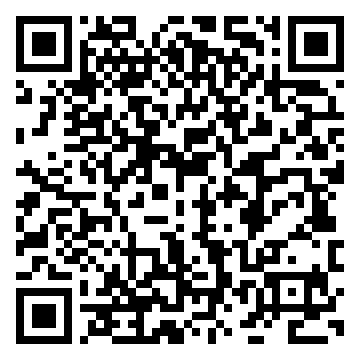

# PlayStation Controller Manager para Zhihe

Transforma um pendrive 4G **Zhihe / UFI** (Qualcomm MSM8916, ~R$ 30) num **receptor Bluetooth de
controles PlayStation para o PC**. Os controles conectam no Zhihe por Bluetooth e o PC enxerga, pela
USB, um **DualShock 4 com fio** (ou um **controle Xbox 360**) por controle — sem drivers, sem DS4Windows,
sem Bluetooth no PC.

> **Versão 0.5.0 — BETA.** O sistema e o programa estão em uso e testados; a instalação pela imagem
> (kit do Release) ainda está em teste. Faça por sua conta e risco.

## O que faz

- **Até 4 controles ao mesmo tempo**: DualShock 4 (original e paralelos), DualShock 3 (original e
  paralelos) e controles genéricos Bluetooth (iPega e parecidos, modo Android).
- **Modo nativo (DualShock 4)** por padrão: os jogos com suporte a PS4 mostram os botões PlayStation.
  DualShock 3 e genéricos também aparecem como DualShock 4 (o DS3 com o nome "PLAYSTATION(R)3 Controller").
- **Modo Xbox 360 (XInput)** nos slots 1 e 2, para jogos e emuladores que só entendem Xbox.
- **Áudio e microfone no DualShock 4**: o PC ganha uma placa de som; o som sai no alto-falante ou no
  fone ligado no controle, e o microfone do headset funciona.
- **Vibração, barra de luz por slot (DS4) e LEDs do DS3**, bateria de cada controle no programa.
- O Zhihe funciona **sozinho**: o programa do Windows só é necessário para configurar.

## Programa do Windows

O **PlayStation Controller Manager** (Windows 10/11) mostra os controles conectados e permite:

- parear controles novos (busca e conecta sozinho);
- escolher o modo de cada slot (Nativo / Xbox);
- escolher qual controle recebe áudio e microfone;
- **sincronizar o DualShock 3 pelo cabo** (grava o endereço do Zhihe no controle; o instalador já
  inclui o driver);
- esquecer / desconectar controles;
- **atualizar o Zhihe** direto do GitHub, pela USB (Configurações).

## Instalação

### 1. Sistema do Zhihe

Baixe o **`zhihe-imagem-0.5.0.zip`** do [Release](../../releases) e siga o `LEIA-ME.txt` que vem
dentro. Em resumo (Windows):

1. Extraia o zip e coloque ao lado a pasta `platform-tools` do Android
   ([SDK Platform-Tools](https://developer.android.com/tools/releases/platform-tools)).
2. Ligue o Zhihe (com o Android de fábrica) no PC e rode o **`instalar.bat`**, opção 1.

O instalador faz o **backup do `persist`** (calibração do rádio) **do próprio aparelho** antes de
trocar a tabela de partições, e o devolve depois — cada Zhihe tem o seu. As partições de firmware
(modem, IMEI etc.) ficam onde estão. Sem adb com root, use o modo EDL (detalhes no `LEIA-ME.txt` e na
[wiki do Zhihe](https://wiki.nura.eco/wiki/Zhihe_series_LTE_dongles_(generic-zhihe)#Debug_UART_pin_and_test_pins)).

### 2. Programa do Windows

Baixe e rode o **`Instalar-PlayStation-Controller-Manager-0.5.0.exe`** do [Release](../../releases).

### 3. Atualizações

No programa: **Configurações > Atualizar Zhihe**. Ele procura a versão mais nova aqui no GitHub e
envia ao Zhihe pela USB (o pacote `zhihe-atualizacao-*.tar.gz` do Release).

## Uso

| Ação | Como |
|---|---|
| Ligar um controle já pareado | Aperte **PS** |
| Parear um controle novo | Programa > Pareamento > Procurar (controle em modo de pareamento) |
| DualShock 3 | Ligue no PC pelo cabo e clique em **Sincronizar controle** no programa |
| **Desligar o Zhihe antes de tirar da USB** | Segure **Select + Start** (DualShock 4: **Share + Options**) por 3 s |

**LED do Zhihe:** azul piscando = pareando · azul = controle conectado · verde = ligado ao PC ·
vermelho = só energia · apagado depois do Select + Start = pode tirar da USB.

## Limitações conhecidas

- No máximo 4 controles; o modo Xbox só nos slots 1 e 2.
- Áudio/microfone em **um** DualShock 4 por vez.
- O **Wi-Fi do Zhihe fica desligado**: ele divide o rádio com o Bluetooth e prejudica áudio e
  controles. A manutenção é pela serial USB.
- Ao conectar ou desconectar um controle o PC "re-detecta" o Zhihe (1–2 s).

## Hardware testado

Zhihe UFI-001C (MSM8916, 4 GB eMMC) com postmarketOS e lk2nd. Controles: DualShock 4 original e
paralelo, DualShock 3 paralelos, iPega (modo Android).

## Apoie o projeto

Se este projeto te ajudou, considere fazer uma doação via **Pix** (qualquer valor):



**Pix copia e cola:**

```
00020126580014BR.GOV.BCB.PIX01362c7f2bbb-2b6b-4b41-8b5c-b47a222531d65204000053039865802BR5915VERIDIANO SILVA6008REDENCAO62070503***6304DD08
```

Chave aleatória: `2c7f2bbb-2b6b-4b41-8b5c-b47a222531d6` (Veridiano Silva)

## Créditos

- [postmarketOS](https://postmarketos.org) — sistema base do Zhihe
- [msm8916-mainline](https://github.com/msm8916-mainline): [Linux](https://github.com/msm8916-mainline/linux),
  [lk2nd](https://github.com/msm8916-mainline/lk2nd) e [qhypstub](https://github.com/msm8916-mainline/qhypstub)
- [BlueZ](http://www.bluez.org) — pilha Bluetooth do Linux
- [BlueRetro](https://github.com/darthcloud/BlueRetro) e o driver `hid-sony` do Linux — referência dos
  protocolos dos controles (nenhum código copiado)
- [Wiki nura.eco](https://wiki.nura.eco/wiki/Zhihe_series_LTE_dongles_(generic-zhihe)) — documentação do Zhihe

## Licença

O **PlayStation Controller Manager** (programa do Windows e serviço do Zhihe) é **gratuito e de código
fechado** — veja [LICENSE.txt](LICENSE.txt).

Os componentes de terceiros mantêm as suas licenças. O kernel Linux do Zhihe é GPL-2.0: as alterações
feitas nele (e a configuração usada) estão em [`gpl/`](gpl/).

PlayStation, DualShock e DualSense são marcas da Sony Interactive Entertainment; Xbox é marca da
Microsoft. Este projeto não tem relação com essas empresas.
